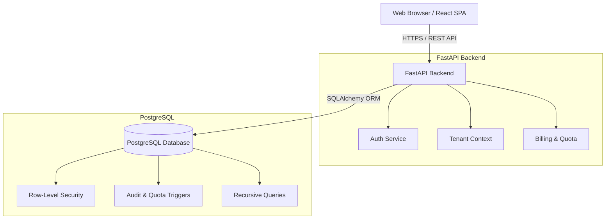
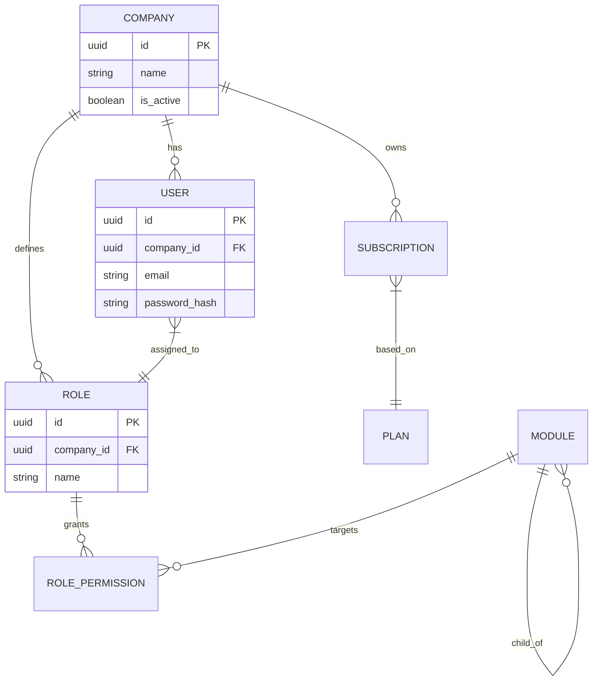

# B2B Multi-Tenant SaaS Platform

Büyük ölçekli B2B SaaS (Software as a Service) uygulamaları için tasarlanmış, çok kiracılı (multi-tenant) mimariye sahip kapsamlı bir platformdur. Bu proje, şirketlerin (tenant) kendi kullanıcılarını, rollerini, yetkilerini ve abonelik planlarını yönetebileceği güvenli ve izole bir ortam sunar.

## Temel Özellikler (Real-world SaaS Problem Solved)
Geleneksel uygulamaların aksine, B2B SaaS sistemlerinde veri izolasyonu, rol tabanlı erişim kontrolü (RBAC) ve hiyerarşik yetkilendirme büyük bir problemdir. Bu platform:
- Row-Level Security (RLS) ile tenant'lar arası veri izolasyonunu sağlar.
- Recursive CTE'ler ile sınırsız derinlikte modül/yetki hiyerarşisi sunar.
- Abonelik limitleri ve kota yönetimini veritabanı seviyesinde trigger'lar ile garanti altına alır.

## Mimari Genel Bakış (Architecture Overview)



## ER Diyagramı (ER Diagram)



## Yetkilendirme Akışı (Authorization Flow)
1. Kullanıcı e-posta ve şifre ile giriş yapar, JWT token alır.
2. Her API isteğinde JWT token `Authorization` header ile sunucuya iletilir.
3. Backend middleware, token'ı doğrular ve kullanıcının `company_id` ve `role_id` bilgilerini çıkarır.
4. İlgili endpoint'e erişim öncesi kullanıcının yetkileri veritabanından çekilerek kontrol edilir.

## Recursive Yetkilendirme (Recursive Authorization)
Modüller (örneğin: `Settings > Users > Edit`) hiyerarşik bir yapıdadır. Alt modüle verilen yetki, üst modül hiyerarşisini de ilgilendirir. Recursive CTE kullanılarak bir rolün erişebildiği tüm hiyerarşik modül ağacı tek bir SQL sorgusu ile getirilir.

```sql
WITH RECURSIVE module_tree AS (
    SELECT id, parent_id, name, 1 as level
    FROM modules
    WHERE id = :target_module_id
    UNION ALL
    SELECT m.id, m.parent_id, m.name, mt.level + 1
    FROM modules m
    INNER JOIN module_tree mt ON m.id = mt.parent_id
)
SELECT * FROM module_tree;
```

## Trigger'lar (Triggers)
- **Audit Logs:** Kritik tablolardaki (örn: `users`, `roles`, `subscriptions`) her `INSERT`, `UPDATE`, `DELETE` işlemi bir trigger vasıtasıyla `audit_logs` tablosuna kaydedilir.
- **Quota Limits:** Yeni bir kullanıcı eklenirken `before_insert` trigger'ı, şirketin mevcut planındaki kullanıcı limitini kontrol eder. Limit aşıldıysa exception fırlatır.

## İşlem Akışı (Transaction Flow - Subscription Upgrade)
Abonelik yükseltme işlemi ACID standartlarında bir transaction içinde gerçekleşir:
1. `BEGIN` transaction.
2. Eski abonelik statüsü `cancelled` veya `upgraded` olarak güncellenir.
3. Yeni plan bilgileriyle `subscriptions` tablosuna yeni kayıt atılır.
4. Fatura (invoice) kaydı oluşturulur.
5. `COMMIT` (Eğer herhangi bir hata olursa `ROLLBACK` edilir).

## Eşzamanlılık (Concurrency Handling)
Veritabanında eşzamanlı limit aşımlarını engellemek için kritik işlemlerde `SELECT ... FOR UPDATE` (Pessimistic Locking) kullanılır. Örneğin fatura kesimi veya kota artırımı sırasında `company` kaydı kilitlenerek Race Condition durumlarının önüne geçilir.

## İndeksleme Stratejisi (Indexing Strategy)
- Yabancı anahtarlar (`company_id`, `role_id`) üzerinde B-Tree indeksleri bulunur.
- E-posta gibi benzersiz aramalar için `UNIQUE INDEX` kullanılır.
- Hiyerarşik sorguları hızlandırmak için `parent_id` üzerinde indeksleme yapılmıştır.
- Soft delete (`is_deleted = false`) alanları olan tablolarda Partial Index kullanılarak performans artırılmıştır.

## Güvenlik Özeti (Security Overview)
- **Row-Level Security (RLS):** PostgreSQL seviyesinde her sorgu `current_setting('app.current_tenant')` fonksiyonunu kullanarak sadece ilgili şirketin verilerini döndürür. Backend'de bir zafiyet olsa bile veritabanı diğer tenant'ların verisini sızdırmaz.
- **Şifreleme:** Şifreler bcrypt ile hashlendikten sonra saklanır.
- **CORS & Rate Limiting:** API seviyesinde yapılandırılmıştır.

## Performans ve Gelecek İyileştirmeler (Performance & Future Optimizations)
- **Redis Caching:** Sık kullanılan yetki ağaçları (permission trees) ve konfigürasyon verileri Redis'e alınabilir.
- **Read Replicas:** Raporlama ve analitik sorgular (örneğin Dashboard istatistikleri) Read Replica üzerinden çalıştırılabilir.

## Olası Genişletmeler (Possible Extensions)
- Çoklu dil (Multi-language) desteği eklenebilir.
- Ödeme geçitleri (Stripe, Iyzico vb.) entegre edilerek gerçek ödeme adımları eklenebilir.
- Webhooks ile dış sistemlere anlık veri akışı sağlanabilir.
